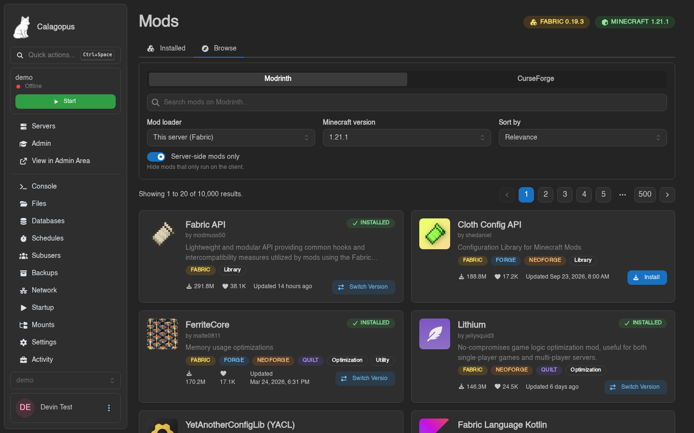
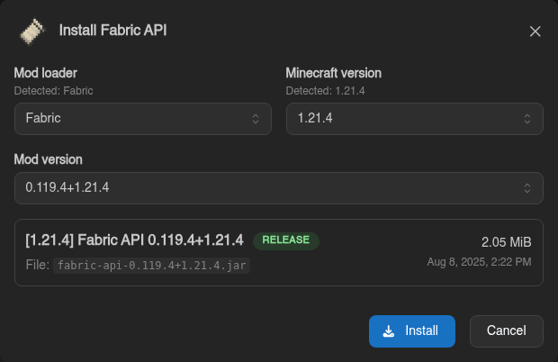
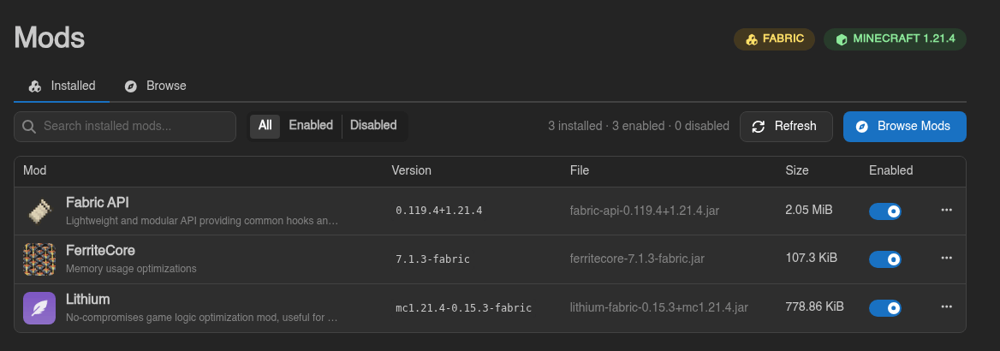

# MC Mod Installer

A [Calagopus Panel](https://calagopus.com) extension that makes installing and managing Minecraft mods
easy. Browse [Modrinth](https://modrinth.com) and [CurseForge](https://www.curseforge.com/minecraft), install
mods with their dependencies, keep them up to date and manage everything in the server's `mods` folder, all
from the server's **Mods** page.

Package name: `dev.caloptreyx.modinstaller` · Requires panel `>=1.2.10`

## Features

- **Browse** Modrinth and, once an administrator adds a key, CurseForge mods (switch the source at the top).
  Search, mod loader, Minecraft version, category (CurseForge) and sorting; filters start at the server's
  detected loader and Minecraft version and are kept in the address, so a search can be shared. A Quilt
  server also finds Fabric mods, NeoForge for 1.20.1 also Forge mods.
- **Mod Details page** for both sources with the full description and a **Versions** tab (search, loader,
  Minecraft version and channel filters; release versions by default).
- **Install** with the mod loader, Minecraft version and mod version preset to the server. Beta and alpha
  versions are behind a toggle. A version made for another loader or Minecraft version can only be installed
  after confirming that the server really runs it.
- **Dependencies**: required mods (Modrinth and CurseForge) are listed in the install dialog with a version that
  fits the server and installed together with the mod; mods that are already installed are recognised, also when
  they came from the other source. Installed mods the new one is incompatible with are shown as a warning.
- **Every download is checked**: after the panel downloads a file, its hash is compared with the one Modrinth
  (SHA-512) or CurseForge (fingerprint) published. A file that doesn't match is removed and the previous version
  stays. Downloads only come from `cdn.modrinth.com`, `edge.forgecdn.net` and `mediafilez.forgecdn.net`, and only
  single `.jar` file names are written.
- **Safe version switches**: when the new file has the same name, the old one is kept as `<name>.backup` until
  the new one is checked, and restored if anything fails. When the name differs, the old file is deleted only
  after the new one is checked; if that delete fails you are told which file is left.
- **CurseForge files the author only offers on CurseForge** are marked "Manual download". The extension first
  looks for the identical file on Modrinth (by SHA-1) and offers to install that. Otherwise it links to the file
  on CurseForge and lets you upload the `.jar` you downloaded: it is uploaded under a temporary name no loader
  reads, its CurseForge fingerprint is checked, and only then it is moved into place ("This isn't the file from
  CurseForge" otherwise). No download links are made up from file ids.
- **Installed mods**: every `.jar` in `mods/` is identified on Modrinth by SHA-1 and, if Modrinth doesn't know
  it, on CurseForge by fingerprint. Rows show the source, version and these problems: the same mod twice, a file
  for another loader or Minecraft version, client-only mods, missing required dependencies and installed
  incompatible mods. Filters for updates and problems; cards instead of a table on phones.
- **Updates**: a row offers "Update to x.y" when a newer release exists for the server's loader and Minecraft
  version (Modrinth's update endpoint, CurseForge fingerprint matches). "Update all" shows the list first and
  updates one mod at a time, waiting out the panel's download limit (5 per minute per server by default).
- **Modpacks**: if the server has a `/.modpack-installer.json` marker, a banner names the pack. When the marker
  lists the pack's files, those rows are marked "From pack …" and updating, switching or deleting them asks for
  confirmation first.
- **Enable or disable** a mod with one switch. Disabled mods are renamed to `<file>.jar.disabled`, so the
  mod loader skips them. Renames and deletes the panel skips (for example files hidden from a subuser) are
  reported as errors, and enabling never overwrites an existing file.
- **Server software panel**: click the badges next to the title to see the detected software, Minecraft version
  and loader/build version, where each came from and how sure it is, every hint that was found, disagreeing
  hints and a note when the log is older than the install. **Set manually…** saves an override; **Clear
  override** removes it.
- Servers that don't run a mod loader (Paper and other plugin servers, proxies, vanilla, or games other than
  Minecraft) show a short explanation with the detected software instead of the Mods pages.

## Screenshots

**Browse**: Modrinth mods filtered to the detected loader and Minecraft version.



**Install Mod modal**: loader and Minecraft version default to what was detected.



**Installed**: every jar in `mods/`, identified on Modrinth and CurseForge, with enable switches.



## Installation

Download `dev_caloptreyx_modinstaller.c7s.zip` from the
[latest release](https://github.com/Caloptreyx/MC-Mod-Installer/releases/latest). Then either upload it
under **Admin → Extensions**, or put it in your heavy image's `build/extensions/` directory and run
`docker compose restart web`. Extensions require the `:heavy` panel image (or a dev environment); see the
[Calagopus docs](https://calagopus.com/docs/panel/extensions/installing-extensions).

The **Mods** page appears in every server's sidebar. The panel can't hide an extension page per server, so on
servers without a mod loader the page only shows a short explanation; to hide it for eggs that never run mods,
use the egg configuration's route order.

### CurseForge API key

Modrinth works without configuration. To also offer CurseForge:

1. Create an API key in the [CurseForge for Studios console](https://console.curseforge.com/).
2. Open **Admin → Extensions → MC Mod Installer**, paste the key and click **Save**. **Test this key** checks a
   key against CurseForge before saving, **Test stored key** checks the saved one, **Remove key** turns
   CurseForge off again.

The key is stored encrypted in the panel settings and never sent to browsers; the settings page only shows
whether a key is set. Saving or removing it is recorded in the admin activity log, without the key. All
CurseForge requests go through the panel, are cached (searches, projects and files 5 minutes, categories 6
hours, fingerprint matches 24 hours) and limited per user, so a single user can't use up the key's quota.

## How detection works

Every hint is collected and ranked; each value comes from the best-ranked hint that agrees with the chosen
software, and hints that disagree are listed as conflicts:

1. **Manual override**: `/.mc-mod-installer.json` in the server root, written by **Set manually…**:
   `{ "override": { "software": "fabric", "minecraftVersion": "1.21.1", "loaderVersion": null }, "setAt": "…" }`.
   Software ids: `fabric quilt forge neoforge mohist arclight youer vanilla paper purpur folia spigot bukkit
   sponge velocity bungeecord waterfall`. An unreadable file is ignored and shown in the evidence.
2. **Launch arguments**: `unix_args.txt`, `run.sh` and the `@libraries/…/unix_args.txt` file it starts
   (`--fml.mcVersion`, `--fml.forgeVersion`, `--fml.neoForgeVersion`, `--fml.forgeGroup net.neoforged`), and the
   Forge `forge-<mc>-<build>-shim.jar`.
3. **Server log and `version_history.json`**, but only when they are newer than the install (server jars,
   loader library folders, `unix_args.txt`, the install time in markers). An older log only counts as a weak
   hint and the panel says it is stale, so a switch made by another tool shows right away.
4. **Install markers** other tools leave: `.mcvc-type.json` and `.modpack-installer.json`.
5. **Server files**: loader libraries (`libraries/net/fabricmc`, `org/quiltmc`, `net/minecraftforge/forge`,
   `net/neoforged`; the newest wins, so leftovers of an earlier loader don't), launcher and server jar names,
   `versions/<version>` (newest folder), Paper/Purpur/Spigot/Bukkit config files (only when not older than the
   server jar), proxy configs and `mohist-config/`. Folia and hybrids (Mohist, Arclight, Youer) are recognised
   from their names and beat the Paper config and loader libraries they also have.
6. Stale logs and config files.
7. **Startup variables** the user can see (never secret ones), e.g. `MINECRAFT_VERSION`, `SERVER_TYPE`,
   `NEOFORGE_VERSION`.
8. **Egg**: the egg name, then nest name, startup command and Docker image (whole words only).

Launch arguments and markers that are older than newer files of another loader lose to them. Snapshots,
pre-releases and year-numbered versions (`26.1.2`, NeoForge `26.1.2.x`) are recognised. Reading file contents
(log, launch scripts, markers, the override) needs `files.read-content`; without it only listings, variables and
the egg are used.

## Permissions

The extension uses the panel's existing file permissions:

| Action | Permission |
| --- | --- |
| View the Mods pages, browse | `files.read` |
| Identify installed mods, read the log, launch scripts, markers and the override | `files.read-content` |
| Install a mod (also uploads and the hash check) | `files.create` |
| Enable / disable a mod | `files.update` |
| Switch or update a mod's version | `files.create` and `files.delete` |
| Delete a mod | `files.delete` |
| Set / clear the manual override | `files.create` + `files.update` / `files.delete` |

Installs, uploads, renames and deletions go through the panel's own file endpoints, so they respect subuser
ignored files and appear in the server's activity log.

Administrators need the extension's own admin permissions: `modinstaller.read` to see the settings and
`modinstaller.manage` to change or test the CurseForge key.

## Development

This repository uses the extension's development layout (`Cargo.toml`, `Metadata.toml`, `src/`,
`frontend/`). Symlink it into a panel checkout as `backend-extensions/dev_caloptreyx_modinstaller`, then
run from the panel root:

```bash
SQLX_OFFLINE=true cargo clippy -p dev_caloptreyx_modinstaller --all-targets
SQLX_OFFLINE=true cargo test -p dev_caloptreyx_modinstaller
node --test "tests/*.test.ts"   # from this repository
cd frontend && ./node_modules/.bin/tsc && ./node_modules/.bin/oxlint extensions/dev_caloptreyx_modinstaller && ./node_modules/.bin/oxfmt --check extensions/dev_caloptreyx_modinstaller && cd ..
SQLX_OFFLINE=true panel-rs extensions export dev.caloptreyx.modinstaller   # -> exported-extensions/
```

Backend routes (`src/`), all under `/api/client/servers/{server}/mod-installer`:

| Route | Permission | What |
| --- | --- | --- |
| `GET /environment` | `files.read` | Detection (pure, unit-tested `src/detect.rs`) |
| `GET /mods` | `files.read` | `mods/` listing; SHA-1 and CurseForge fingerprints (with `files.read-content`), the modpack marker |
| `POST /verify` | `files.create` | `{ file, algorithm: sha1\|sha256\|sha512\|curseforge, expected }` → `{ matches }` for one file in `mods/` |
| `GET /curseforge/status` | `files.read` | `{ curseforge: bool }` |
| `GET /curseforge/search` | `files.read` | `query, loader, game_version, category, sort, page, per_page` |
| `GET /curseforge/categories` | `files.read` | Mod categories |
| `GET /curseforge/summaries?ids=` | `files.read` | Up to 50 project summaries |
| `GET /curseforge/projects/{id}` | `files.read` | Project with HTML description |
| `GET /curseforge/projects/{id}/files` | `files.read` | Files, optionally `loaders=fabric,quilt` and `game_version` |
| `GET /curseforge/projects/{id}/files/{file}` | `files.read` | One file |
| `POST /curseforge/fingerprints` | `files.read-content` | `{ fingerprints (≤ 500), loaders, game_version }` → matches with updates, required dependencies |

Admin routes under `/api/admin/extensions/dev.caloptreyx.modinstaller`: `GET`/`PUT /settings`
(`modinstaller.read` / `modinstaller.manage`) and `POST /curseforge/verify` (`modinstaller.manage`).

The frontend (`frontend/src/`) talks to the Modrinth API directly from the browser and to CurseForge through
the routes above. Installs use the panel's file pull endpoint (uploads its upload endpoint); enabling,
disabling, deleting and the override use its rename, delete and write endpoints.

## License

[MIT](LICENSE)
